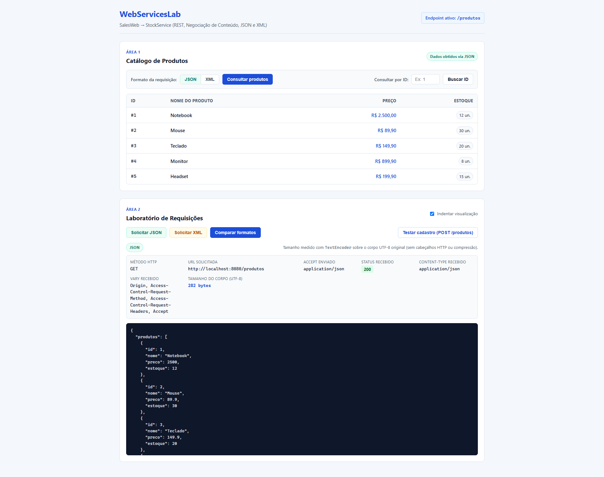
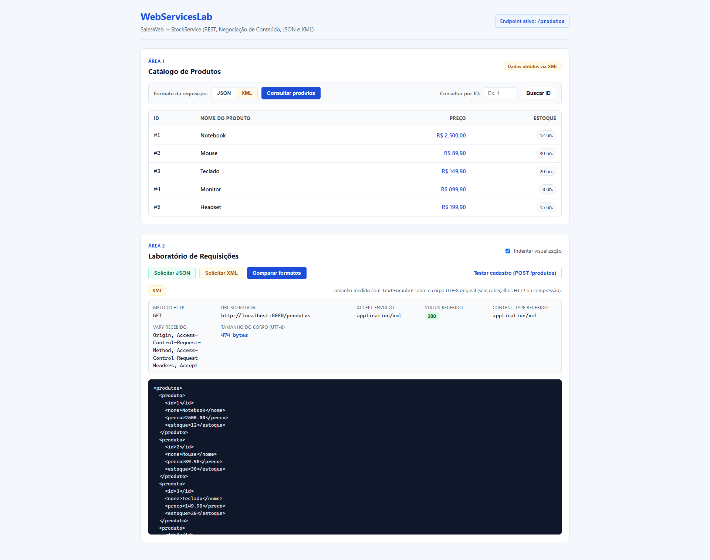
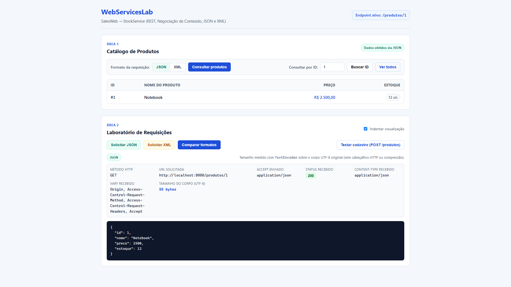
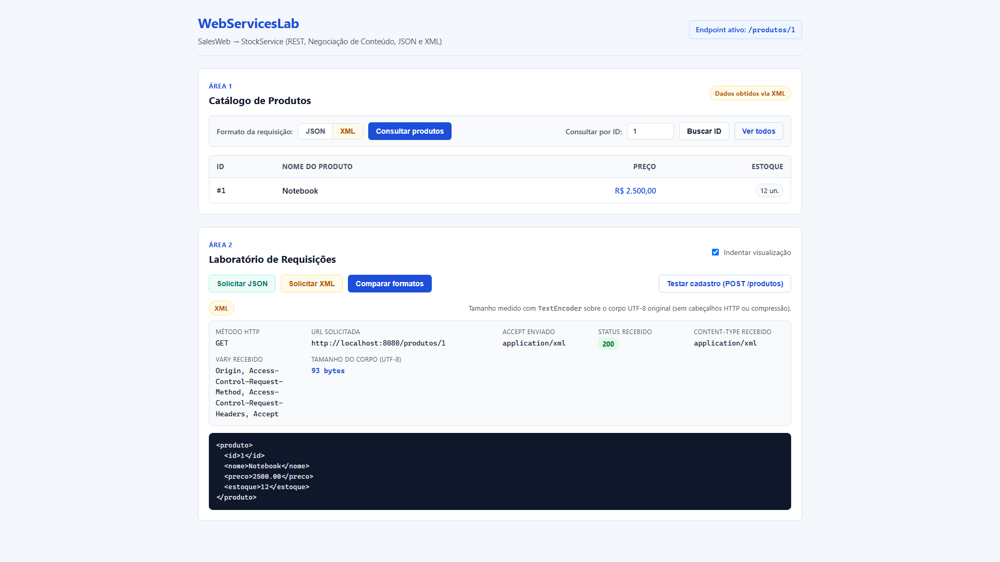
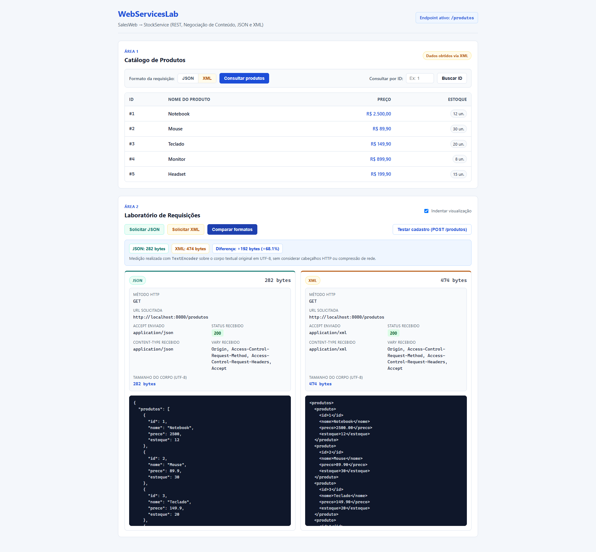
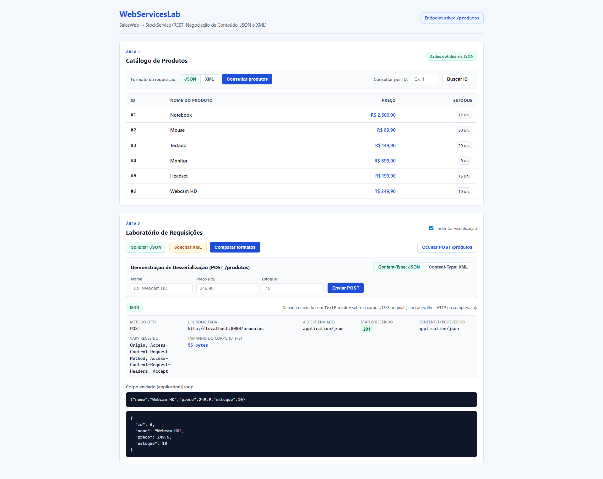
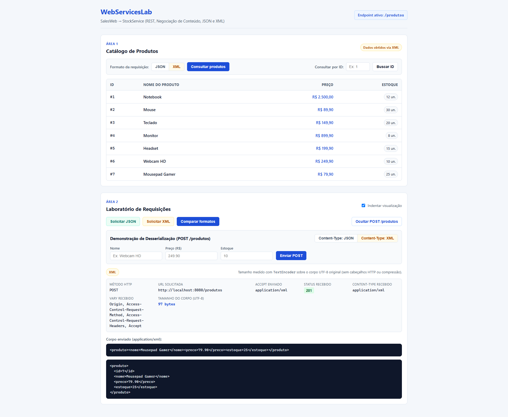
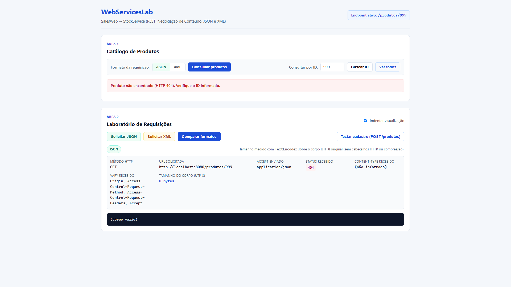

# StockService — WebServicesLab

Web Service REST em **Java + Spring Boot** do projeto acadêmico **WebServicesLab** (SENAI), desenvolvido para disponibilizar produtos em estoque com **negociação de conteúdo real** nos formatos **JSON** e **XML**.

- **Repositório do Front-end (`SalesWeb`)**: https://github.com/RHU4N/SalesWebJsonXml

## Tecnologias Utilizadas

- **Java**: `25.0.3` (`<java.version>25</java.version>`)
- **Spring Boot**: `4.2.0` (`spring-boot-starter-webmvc`, `spring-boot-starter-validation`)
- **Jackson**: BOM `3.1.8` (JSON + `tools.jackson.dataformat:jackson-dataformat-xml`)
- **Maven**: `Apache Maven 3.10.1` via Maven Wrapper (`mvnw` / `mvnw.cmd`)

## Produtos Iniciais em Memória

| ID | Nome | Preço | Estoque |
|---|---|---:|---:|
| 1 | Notebook | 2500.00 | 12 |
| 2 | Mouse | 89.90 | 30 |
| 3 | Teclado | 149.90 | 20 |
| 4 | Monitor | 899.90 | 8 |
| 5 | Headset | 199.90 | 15 |

> Os dados são mantidos em memória (`CopyOnWriteArrayList`) sem banco de dados.

## Endpoints Disponíveis (`http://localhost:8080`)

| Método | Rota | Descrição | Negociação (`Accept` / `Content-Type`) | Status HTTP |
|---|---|---|---|---|
| `GET` | `/produtos` | Lista todos os produtos (`ProdutosResponse`) | `application/json`, `application/xml` | `200`, `406` |
| `GET` | `/produtos/{id}` | Busca um produto específico por ID (`Produto`) | `application/json`, `application/xml` | `200`, `404`, `406` |
| `POST` | `/produtos` | Cadastra produto em memória (desserialização) | `application/json`, `application/xml` | `201`, `400`, `406`, `415` |

- Quando o cabeçalho `Accept` não especifica preferência, o padrão configurado em `WebConfig` é `application/json`.
- As respostas incluem o cabeçalho `Vary: Accept` e CORS liberado para `http://localhost:5173`.

## Comparação Prática de Tamanho (Corpo UTF-8 Original)

| Recurso | JSON (bytes UTF-8) | XML (bytes UTF-8) | Diferença |
|---|---:|---:|---:|
| `GET /produtos` (5 produtos iniciais) | `282` | `474` | `+192 bytes (+68.1%)` |
| `GET /produtos/1` (Notebook) | `55` | `93` | `+38 bytes (+69.1%)` |

> Medição realizada sobre o corpo textual original em UTF-8, sem cabeçalhos HTTP ou compressão de rede.

## Exemplos com `curl`

```bash
curl -i -H "Accept: application/json" http://localhost:8080/produtos/1
curl -i -H "Accept: application/xml" http://localhost:8080/produtos/1
curl -i -H "Accept: text/plain" http://localhost:8080/produtos
```

## Como Executar Localmente

```powershell
$env:JAVA_HOME = 'C:\Program Files\JetBrains\IntelliJ IDEA 2026.1.1\jbr'
$env:Path = "$env:JAVA_HOME\bin;$env:Path"
.\mvnw.cmd spring-boot:run
```

Para executar os testes automatizados (`11/11` aprovados):

```powershell
.\mvnw.cmd test
```

---

## Evidências de Funcionamento

As capturas reais e os corpos brutos `.json`/`.xml` estão organizados na pasta [`evidencias/`](evidencias/) para fácil acesso e download.

### Listagem `/produtos` em JSON e XML



### Consulta Individual `/produtos/1` em JSON e XML



### Comparação Lado a Lado (`282 bytes` vs `474 bytes`)


### Desserialização via `POST /produtos` (`HTTP 201`) e Erro `HTTP 404`



